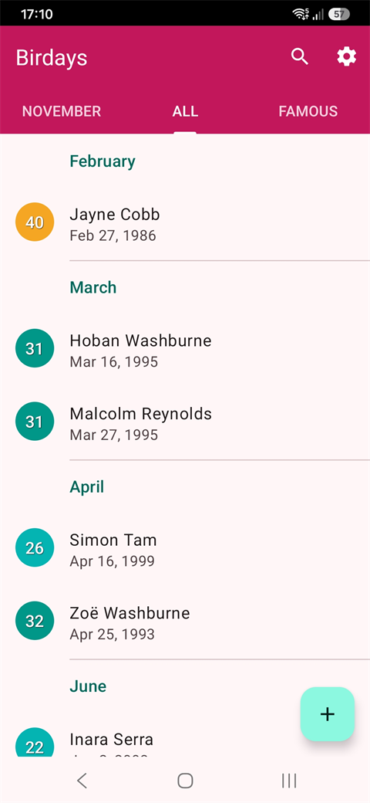
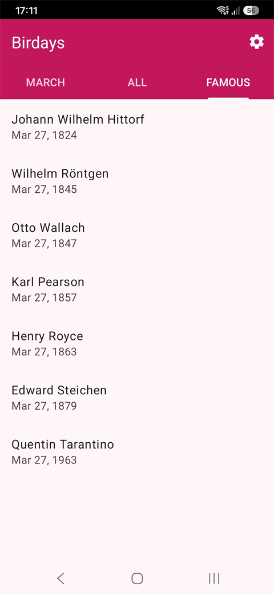
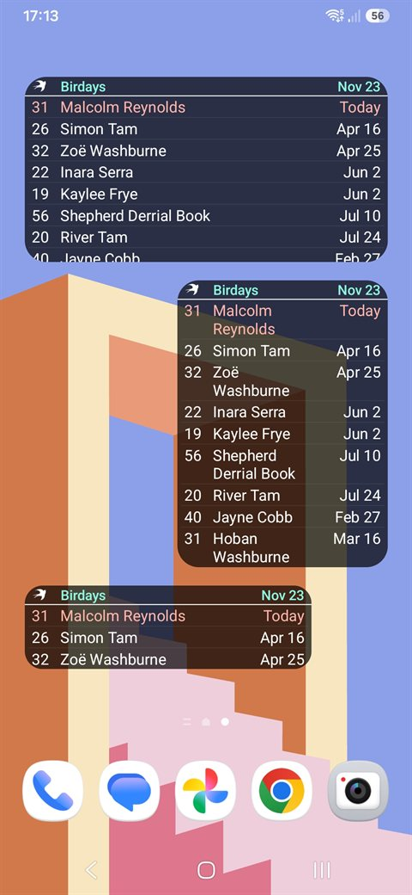
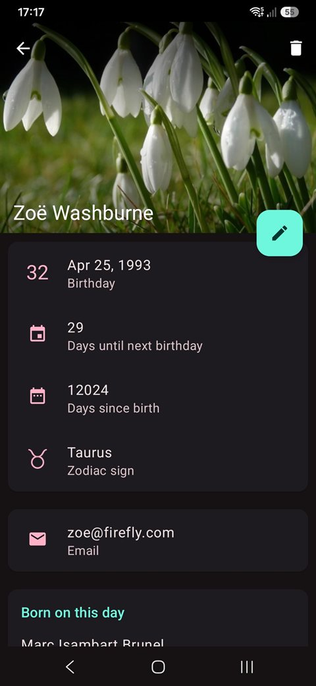

# Birdays

[](https://opensource.org/licenses/Apache-2.0)
[](https://android-arsenal.com/api?level=26)

*Simple, elegant birthday tracking app with a home screen widget and famous people's birthdays.*

---

## 📱 Screenshots

| All birthdays | Famous birthdays | Home screen widget | Person details |
|:---:|:---:|:---:|:---:|
|  |  |  |  |

---

## 🚀 What's New in the Latest Update

Birdays has been completely modernized after nearly 10 years of inactivity to meet modern Android standards:
* **Material Design 3 (M3):** Refreshed UI, color palette, modern typography, and updated components.
* **AndroidX & Modern Architecture:** Fully migrated to AndroidX, Jetpack libraries, and API 36 support.
* **Google Drive Backup & Restore:** Securely back up and restore your birthday database to your personal Google Drive.
* **Yandex SDK Integration:** Upgraded ad SDK and analytics.
* **Codebase Cleanup:** Removal of legacy deprecated APIs and dead code for optimal performance and battery efficiency.

---

## 🌟 Key Features

* 🎂 **Birthday Tracking & Reminders:** Never miss a birthday with customizable notification times and advance alerts.
* 📲 **Home Screen Widget:** View upcoming birthdays directly from your home screen at a glance.
* 🌟 **Famous Birthdays:** Explore births of famous historical figures and celebrities.
* 📇 **Contacts Import:** Seamlessly import contact birthdays from your device's address book.
* 🌙 **Dark Theme:** Full support for system-wide Light and Dark / Night Mode.

---

## 🌍 Translators

Special thanks to all the amazing contributors who helped translate **Birdays** into multiple languages:

* **Serhii Ponomarenko** (Ukrainian) - [@mellangr](https://github.com/mellangr)
* **Marc Sulser** (German)
* **Pablo Rodríguez** (Spanish) - [@MeLlamoPablo](https://github.com/MeLlamoPablo)
* **Dai Jia** (Chinese Simplified)
* **Uluç Muslu** (Turkish)
* **isaideureka** (Indonesian)
* **Nito** (Norwegian)
* **José Romero** (French)
* **Ruah Timario** (Filipino) - [@ruahtheking](https://github.com/ruahtheking)
* **Belkacem Mohammed** (Kabyle) - [@belkacem77](https://github.com/belkacem77)
* **Miguel Dos Reis** (Portuguese & Spanish)
* **Omer Surer** (Turkish)
* **Xiupeng** (Chinese Traditional)
* **Andra Fetele** (Romanian) - [@sarmizegetusaa](https://github.com/sarmizegetusaa)
* **Claire Dufetrelle** (French) - [@claireduf](https://github.com/claireduf)
* **smmateusz15** (Polish)
* **Goshaproject** (Belarusian)

---

## 📄 License

```text
Copyright 2017-2026 Evgenii Timofeev

Licensed under the Apache License, Version 2.0 (the "License");
you may not use this file except in compliance with the License.
You may obtain a copy of the License at

   http://www.apache.org/licenses/LICENSE-2.0

Unless required by applicable law or agreed to in writing, software
distributed under the License is distributed on an "AS IS" BASIS,
WITHOUT WARRANTIES OR CONDITIONS OF ANY KIND, either express or implied.
See the License for the specific language governing permissions and
limitations under the License.
```
